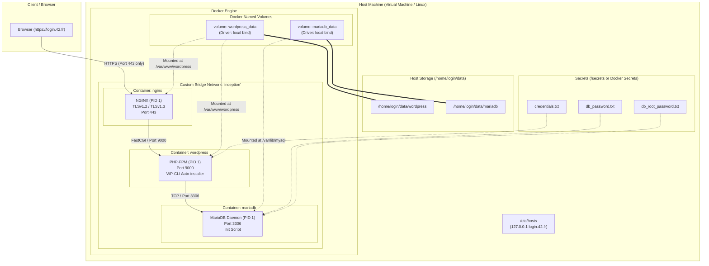
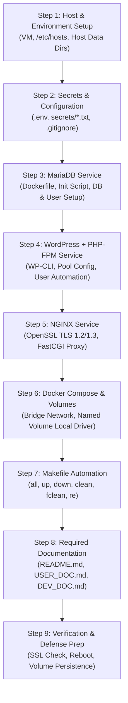

# Inception - System Administration & Docker Architecture Guide

## 1. High-Level System Architecture



---

## 2. Service & Communication Matrix

| Service | Base Image | Exposed to Host | Internal Port | Volume Mount Point | Process (PID 1) |
| :--- | :--- | :--- | :--- | :--- | :--- |
| **NGINX** | `alpine:3.19` or `debian:bullseye` | **Port 443** (HTTPS) | None | `/var/www/wordpress` (Read-Only) | `nginx -g "daemon off;"` |
| **WordPress** | `alpine:3.19` or `debian:bullseye` | **None** | `9000` (FastCGI) | `/var/www/wordpress` (Read-Write) | `php-fpm82 -F` |
| **MariaDB** | `alpine:3.19` or `debian:bullseye` | **None** | `3306` (MySQL) | `/var/lib/mysql` (Read-Write) | `mariadbd` / `mysqld` |

---

## 3. Strict Rules & Constraints (42 Inception v5.3)

1. **Base Image:** Built only from the penultimate stable version of Alpine or Debian (e.g. `alpine:3.19` or `debian:bullseye`).
2. **Prohibited Tags:** The `:latest` tag is strictly forbidden across all Dockerfiles and compose files.
3. **No Ready-Made Images:** It is forbidden to pull pre-made application images (e.g., `FROM wordpress`, `FROM mariadb`, `FROM nginx`).
4. **PID 1 Principle:** Containers must not use hacky patches or infinite loops (`tail -f`, `sleep infinity`, `bash`, `while true`). Services must run directly in the foreground as PID 1.
5. **Single Ingress Point:** Only NGINX container can expose a port to the host (port 443 only with TLSv1.2 or TLSv1.3).
6. **Network:** Must use a custom Docker bridge network (`network: host`, `--link`, and `links:` are prohibited).
7. **Persistent Volumes:**
   - Must use Docker **named volumes** (raw bind mounts in compose service definitions are not allowed).
   - Named volumes must store their underlying data in `/home/<login>/data/mariadb` and `/home/<login>/data/wordpress` on the host machine using local volume driver options.
8. **WordPress Users:**
   - Exactly two users configured in WordPress.
   - One administrator whose username **cannot contain** `admin`, `Admin`, `administrator`, or `Administrator`.
   - One regular user (author/editor).
9. **Domain Name:** Configured via `/etc/hosts` as `<login>.42.fr` pointing to local IP (`127.0.0.1`).
10. **Security & Secrets:**
    - No passwords stored in Dockerfiles or tracked in git.
    - Environment variables stored in `.env`.
    - Credentials stored in Docker secrets / external files ignored by git.

---

## 4. Repository Directory Structure

```
.
├── DEV_DOC.md
├── Makefile
├── README.md
├── USER_DOC.md
├── secrets/                  # Excluded from git
│   ├── credentials.txt
│   ├── db_password.txt
│   └── db_root_password.txt
└── srcs/
    ├── .env                  # Excluded from git
    ├── docker-compose.yml
    └── requirements/
        ├── mariadb/
        │   ├── .dockerignore
        │   ├── Dockerfile
        │   ├── conf/
        │   │   └── 50-server.cnf
        │   └── tools/
        │       └── mariadb_setup.sh
        ├── nginx/
        │   ├── .dockerignore
        │   ├── Dockerfile
        │   ├── conf/
        │   │   └── nginx.conf
        │   └── tools/
        │       └── nginx_setup.sh
        └── wordpress/
            ├── .dockerignore
            ├── Dockerfile
            ├── conf/
            │   └── www.conf
            └── tools/
                └── wp_setup.sh
```

---

## 5. Step-by-Step Implementation Roadmap



### Step 1: Host & Environment Setup
- Configure host DNS resolution in `/etc/hosts`:
  ```bash
  sudo sh -c 'echo "127.0.0.1 <login>.42.fr" >> /etc/hosts'
  ```
- Create host data directories:
  ```bash
  sudo mkdir -p /home/<login>/data/mariadb
  sudo mkdir -p /home/<login>/data/wordpress
  ```

### Step 2: Secrets & Environment Configuration
- Create `secrets/` directory and credential files:
  - `secrets/db_password.txt`
  - `secrets/db_root_password.txt`
  - `secrets/credentials.txt` (WordPress regular user password)
- Create `srcs/.env` with non-secret configurations:
  - `DOMAIN_NAME=<login>.42.fr`
  - `LOGIN=<login>`
  - `MYSQL_DATABASE=wordpress_db`
  - `MYSQL_USER=wp_user`
  - `WP_ADMIN_USER=chief_operator` (cannot contain "admin")
  - `WP_ADMIN_EMAIL=chief@42.fr`
  - `WP_USER=regular_student`
  - `WP_USER_EMAIL=student@42.fr`

### Step 3: MariaDB Service Implementation
- **Dockerfile:** Based on `alpine:3.19` or `debian:bullseye`. Installs `mariadb` and `mariadb-client`.
- **Config:** `conf/50-server.cnf` binds to `0.0.0.0` and listens on port `3306`.
- **Setup script:** `tools/mariadb_setup.sh` initializes DB files (`mariadb-install-db`), starts temporary mysqld, reads root and user passwords from Docker secrets, creates database and users with privileges, shuts down the temporary instance, and executes foreground daemon:
  ```bash
  exec mariadbd --user=mysql --console
  ```

### Step 4: WordPress + PHP-FPM Service Implementation
- **Dockerfile:** Based on `alpine:3.19` or `debian:bullseye`. Installs PHP 8.x, extensions (`php-fpm`, `php-mysqli`, `php-phar`, `php-json`, `php-curl`, `php-mbstring`, etc.), `mariadb-client`, `curl`, and downloads `wp-cli.phar`.
- **Config:** `conf/www.conf` sets `listen = 0.0.0.0:9000` and configures worker pool.
- **Setup script:** `tools/wp_setup.sh` waits for MariaDB connectivity, downloads WordPress core if missing, creates `wp-config.php`, runs `wp core install` with the compliant admin user, creates the secondary user, sets correct permissions (`chown -R www-data:www-data`), and runs PHP-FPM:
  ```bash
  exec php-fpm82 -F
  ```

### Step 5: NGINX Service Implementation
- **Dockerfile:** Based on `alpine:3.19` or `debian:bullseye`. Installs `nginx` and `openssl`.
- **Certificates:** Generates self-signed TLS certificates using OpenSSL for `<login>.42.fr`.
- **Config:** `conf/nginx.conf` sets `ssl_protocols TLSv1.2 TLSv1.3;`, listens on `443 ssl`, sets root to `/var/www/wordpress`, and forwards `.php` requests to `fastcgi_pass wordpress:9000;`.
- **Process:** Runs `nginx -g 'daemon off;'`.

### Step 6: Docker Compose & Volumes Orchestration
- Sets up `srcs/docker-compose.yml` with:
  - Three services (`mariadb`, `wordpress`, `nginx`) using custom builds.
  - Restart policy `restart: always`.
  - Secrets bindings to `/run/secrets/...`.
  - Custom bridge network `inception`.
  - Named volumes bound to host paths:
    ```yaml
    volumes:
      mariadb_data:
        driver: local
        driver_opts:
          type: none
          o: bind
          device: /home/${LOGIN}/data/mariadb
      wordpress_data:
        driver: local
        driver_opts:
          type: none
          o: bind
          device: /home/${LOGIN}/data/wordpress
    ```

### Step 7: Makefile Automation
Root `Makefile` rules:
- `all`: Creates directories and runs `docker compose up -d --build`.
- `up`: Starts containers in background.
- `down`: Stops and removes containers.
- `stop` / `start`: Pauses / resumes containers.
- `status`: Displays running container statuses.
- `clean`: Removes stopped containers and dangling images.
- `fclean`: Complete teardown (`down -v --rmi all`) and host data directory cleanup.
- `re`: `fclean` followed by `all`.

### Step 8: Documentation Requirements
- `README.md`:
  - Italicized first line: `*This project has been created as part of the 42 curriculum by <login>.*`
  - Architectural comparisons:
    - Virtual Machines vs Docker
    - Secrets vs Environment Variables
    - Docker Network vs Host Network
    - Docker Volumes vs Bind Mounts
  - Installation and usage instructions.
  - Resources and AI usage disclosure.
- `USER_DOC.md`: User guide for starting, stopping, accessing web & admin panels, and checking service health.
- `DEV_DOC.md`: Developer guide for setting up environment from scratch, building, and managing volumes.

### Step 9: Optional Bonus Services
- **Redis:** Redis cache container + WordPress Redis Object Cache plugin.
- **FTP Server:** `vsftpd` container pointing to `/var/www/wordpress`.
- **Static Website:** Static HTML/CSS/JS site running on a dedicated port.
- **Adminer:** Web-based database management interface.
- **Extra Service:** Monitoring tool (Portainer, cAdvisor, or Netdata).

---

## 6. Peer Evaluation & Defense Verification Checklist

| Test Item | Verification Command / Method | Expected Result |
| :--- | :--- | :--- |
| **TLS 1.2 Support** | `openssl s_client -connect <login>.42.fr:443 -tls1_2` | Handshake succeeds |
| **TLS 1.3 Support** | `openssl s_client -connect <login>.42.fr:443 -tls1_3` | Handshake succeeds |
| **TLS 1.0 Rejection** | `openssl s_client -connect <login>.42.fr:443 -tls1` | Connection fails / Handshake error |
| **TLS 1.1 Rejection** | `openssl s_client -connect <login>.42.fr:443 -tls1_1` | Connection fails / Handshake error |
| **Port Exposure** | `nc -zv 127.0.0.1 3306` and `nc -zv 127.0.0.1 9000` | Connection refused (ports internal only) |
| **WordPress Access** | Browse to `https://<login>.42.fr` | WordPress homepage loads |
| **Admin Access** | Browse to `https://<login>.42.fr/wp-admin` | Admin login page loads; credentials work |
| **Admin Username** | Inspect WP Users in database or admin panel | No "admin" / "administrator" substring |
| **Data Persistence** | Create a post, `make down`, `make up` | Post persists on reload |
| **Crash Recovery** | `docker kill mariadb` | Docker automatically restarts the container |
| **No Hacky Scripts** | Inspect Dockerfiles & scripts | No `tail -f`, `sleep infinity`, or `while true` |

