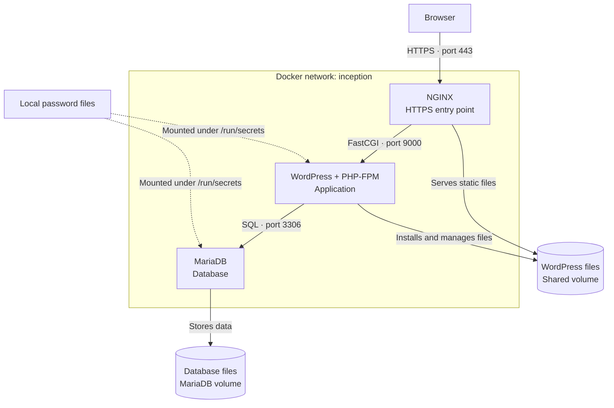

# Inception

*A system administration project from the 42 curriculum, by ajamoun.*

Inception runs a WordPress website using three containers built from custom Dockerfiles: NGINX, WordPress with PHP-FPM, and MariaDB. Docker Compose connects the services, mounts their persistent storage, and provides passwords through secret files.

The project explores how a web server, an application, and a database work together, while practicing Docker images, networking, volumes, TLS, and service initialization.

## Architecture



1. **NGINX** receives HTTPS requests on port 443 using a self-signed certificate. It serves static files and forwards PHP requests to WordPress over FastCGI.
2. **WordPress with PHP-FPM** runs the application. Its startup script waits for MariaDB, downloads and configures WordPress on first setup, and creates an administrator and an author account using WP-CLI.
3. **MariaDB** stores the site's content and user accounts. Its startup script initializes the database and database user when needed.

Only NGINX publishes a port to the host. WordPress and MariaDB communicate through the Compose network using their service names.

## Storage and configuration

The `wordpress` volume is shared by NGINX and WordPress at `/var/www/html`. The `mariadb` volume stores database files at `/var/lib/mysql`. Both volumes bind to host directories under `/home/ajamoun/data`, so the files persist when containers are recreated.

Non-secret settings live in `srcs/.env`. Passwords live in the root `secrets/` directory and are mounted into the containers that need them. Both paths are ignored by Git.

NGINX generates its TLS certificate and private key inside its container when they are missing.

## Project structure

```text
.
├── Makefile
├── README.md
└── srcs/
    ├── docker-compose.yml
    └── requirements/
        ├── mariadb/
        ├── nginx/
        └── wordpress/
```

Each service directory contains its Dockerfile, configuration, and startup script. All three images use `debian:bookworm` as their base.

## Running locally

Install Docker, Docker Compose, and Make. Create `srcs/.env` with:

```dotenv
DOMAIN_NAME=ajamoun.42.fr
MYSQL_DATABASE=wordpress
MYSQL_USER=wpuser
WP_TITLE=Inception
WP_ADMIN_USER=siteowner
WP_ADMIN_EMAIL=admin@example.com
WP_USER=author
WP_USER_EMAIL=author@example.com
```

Create a `secrets/` directory at the repository root with these files, each containing its own password:

- `db_password.txt`
- `db_root_password.txt`
- `wp_admin_password.txt`
- `wp_user_password.txt`

The current configuration uses `ajamoun.42.fr` and `/home/ajamoun/data`. On another machine, update the domain in the configuration and Makefile, and align the volume paths in `srcs/docker-compose.yml` with the data directory created by the Makefile.

Run `make` to create the data directories, add the local hostname to `/etc/hosts` using sudo if needed, and build and start the containers. Open `https://ajamoun.42.fr` and accept the local self-signed certificate. The administration page is available at `/wp-admin`.

Run `make down` to stop and remove the containers. The data remains in the host directories.
